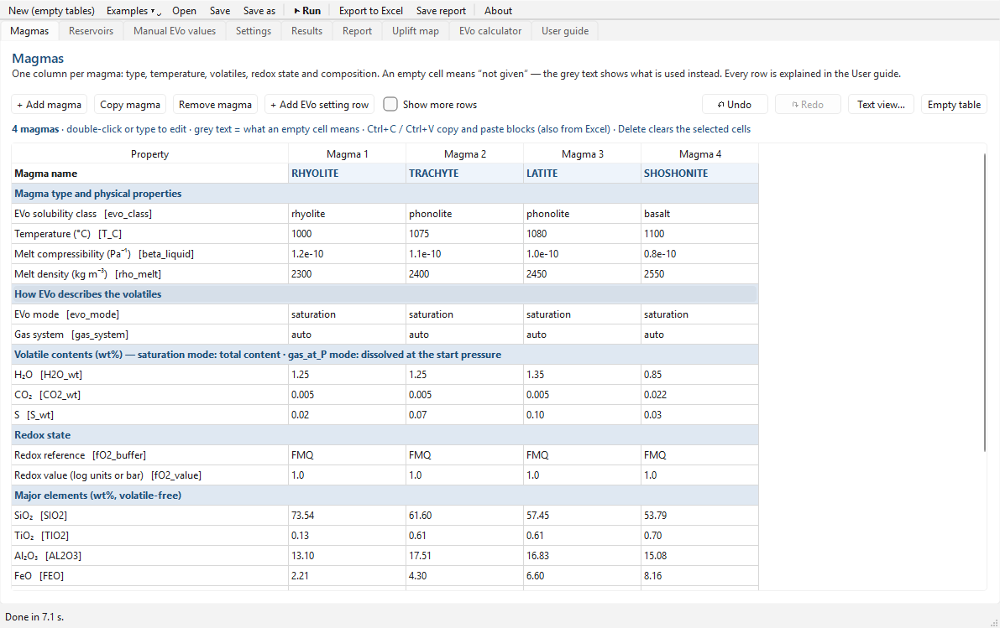
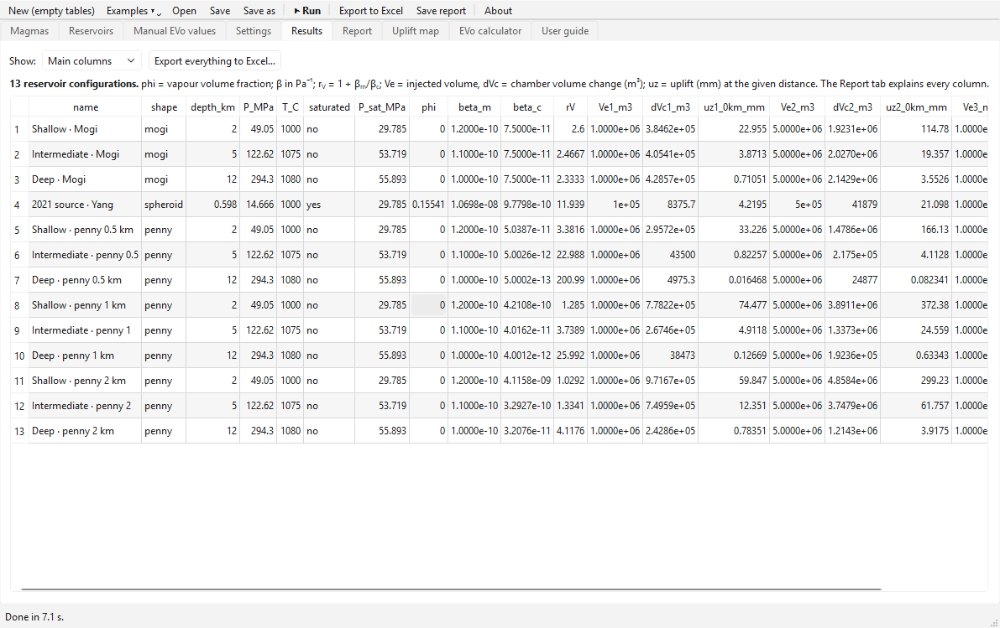
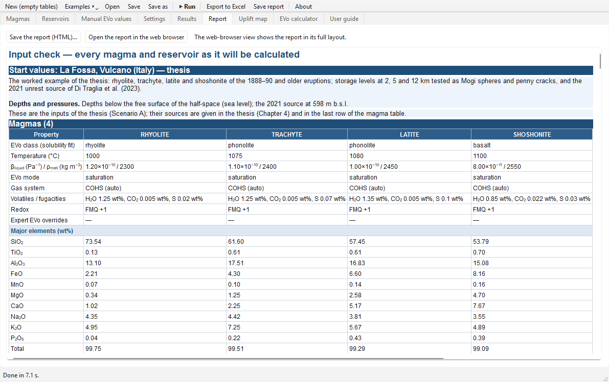
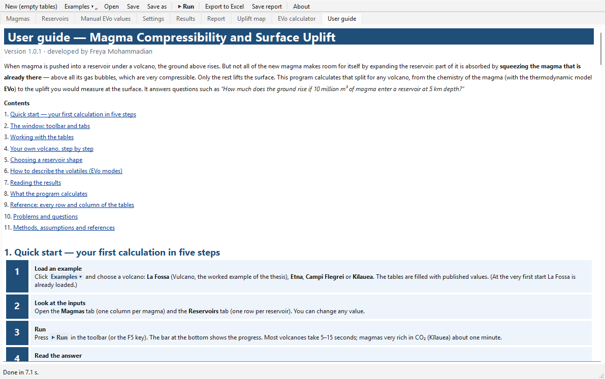
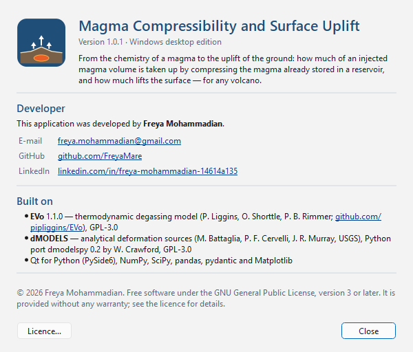

# Magma Compressibility and Surface Uplift — Windows app

A Windows desktop program that runs the seven-step chain of this repository — **EVo** degassing
thermodynamics → magma and chamber compressibility → **dMODELS** deformation sources — for **any volcano**.
It is the desktop edition of
[`notebooks/Magma_Compressibility_Uplift_AnyVolcano.ipynb`](../notebooks/Magma_Compressibility_Uplift_AnyVolcano.ipynb)
and gives exactly the same numbers.

Developed by **Freya Mohammadian** · [freya.mohammadian@gmail.com](mailto:freya.mohammadian@gmail.com) ·
[GitHub](https://github.com/FreyaMare) · [LinkedIn](https://www.linkedin.com/in/freya-mohammadian-14614a135)



## Download and install

1. Open the [latest release](https://github.com/FreyaMare/lafossa-magma-compressibility/releases/latest) and
   download **`MagmaUplift_Setup_<version>.exe`**.
2. Run it. No administrator rights are needed; the program is installed for your user account with a Start-menu
   entry (uninstall from *Settings ▸ Apps*).
3. Windows may show *“Windows protected your PC”* because the installer is not code-signed: click
   **More info ▸ Run anyway**.

Prefer no installation? Download **`MagmaUplift_portable.zip`**, unzip it anywhere and start `MagmaUplift.exe`.

Requirements: Windows 10 or 11, 64-bit, about 300 MB of disk space. Python is **not** needed.

## Using the program

Click **Examples ▾** (La Fossa, Etna, Campi Flegrei, Kīlauea), look at the tables, press **▶ Run** (F5) and read
the **Results** and **Report** tabs. The **User guide** tab inside the program explains everything step by step.

| Tab | Contents |
|---|---|
| **Magmas** | one column per magma: type, temperature, volatiles, redox state, composition |
| **Reservoirs** | one row per reservoir (or geometry to compare): shape, depth, volume, injected volumes, magmas, host rock |
| **Manual EVo values** | optional: your own vapour fractions instead of EVo's for chosen reservoirs |
| **Settings** | crust density, default elasticity, observation distances, EVo options, report options |
| **Results** | the result table (main or all columns) |
| **Report** | every table, note and figure of the calculation; save as HTML or open in the web browser |
| **Uplift map** | map of the uplift around one reservoir |
| **EVo calculator** | one magma at any pressure |
| **User guide** | how to use the program, reference of every row and column |

* Tables work like a spreadsheet: type to edit, Ctrl+C / Ctrl+V (also to and from Excel), Delete, Ctrl+Z.
  Grey text shows what an empty cell means; a red cell is not a number.
* **Save / Open** keep projects as `.mcu` files; the last session is restored automatically.
* **Export to Excel** writes the results, the EVo states, the input tables and the settings.

| | |
|---|---|
|  |  |
|  |  |

### Command-line options

| Command | What it does |
|---|---|
| `MagmaUplift.exe` | opens the window (restores the last session) |
| `MagmaUplift.exe project.mcu` | opens a project file |
| `MagmaUplift.exe --selftest [file]` | thesis example, compared with the verified notebook results (≈ 10 s) |
| `MagmaUplift.exe --check-all [file]` | the four ready-made volcanoes, a test volcano using every EVo mode, the EVo calculator and the map (≈ 2 min) |

The results of `--selftest` / `--check-all` are written to `selftest_result.txt` / `check_all_result.txt` next to
the program, or to the file given.

## How the program works

`magma_uplift/nbcells.py` holds the 18 code cells of the any-volcano notebook, copied verbatim (EVo 1.1.0 and
dmodelspy 0.2 are embedded in cells 2 and 3). `magma_uplift/runner.py` runs them in one Python namespace, as a
Jupyter kernel would: the form fields take the values of the *Settings* tab, the fill-in tables come from the
window, and everything a cell displays goes into the *Report*. The results are therefore identical to the
notebook's; the self-tests compare them with the stored notebook results.

| Path | Contents |
|---|---|
| `run_app.py` | entry point |
| `magma_uplift/` | the program: `runner.py` (runs the cells), `main_window.py`, `table_editor.py`, `guide.py`, `about.py`, `terms.py` (notebook wording → tab names), `app.py` (start-up and self-tests) |
| `magma_uplift/nbcells.py` | the notebook cells (generated) |
| `magma_uplift/selftest_reference.json`, `check_cases.json` | verified notebook results used by the self-tests |
| `tools/make_cells.py` | regenerates `nbcells.py` from the notebook |
| `tools/collect_imports.py` | regenerates `hiddenimports.json` (modules the cells import at run time) |
| `requirements.txt`, `constraints.txt` | exact package versions of the tested build |
| `MagmaUplift.spec`, `installer.iss`, `build_windows.bat` | PyInstaller recipe, Inno Setup installer, one-click build |
| `RELEASE_NOTES.md` | text of the GitHub release |

### Run from source (any operating system)

```bash
cd windows_app
python -m pip install -r requirements.txt -c constraints.txt
python run_app.py
```

### Build the Windows installer yourself

On Windows 10/11 with Python 3.12, 3.13 or 3.14 from python.org, double-click **`build_windows.bat`**. It creates a
private environment `.venv-build` with the pinned packages, runs the self-test from source, builds the program
with PyInstaller into `dist\MagmaUplift`, runs the self-test inside the built program, and writes
`output\MagmaUplift_portable.zip` and — with Inno Setup 6, which it offers to install via winget —
`output\MagmaUplift_Setup_<version>.exe`. The first build downloads about 400 MB and takes 5–15 minutes.

### Automatic builds and releases

The workflow [`.github/workflows/windows-app.yml`](../.github/workflows/windows-app.yml) runs on GitHub's Windows
machines whenever `windows_app/` changes on `main`: it runs `build_windows.bat`, installs the setup silently,
tests the installed program (`--check-all` and a window test with screenshots) and creates a **draft release**
`windows-app-v<version>` with the installer, the portable zip and the test results. Publishing the draft makes it
public.

**New version:** change the version in `installer.iss` (`MyAppVersion`) and `magma_uplift/__init__.py`, describe
the changes in `RELEASE_NOTES.md` and `../CHANGELOG.md`, and push to `main`. After a change to the notebook, run
`tools/make_cells.py` (and `tools/collect_imports.py` if new modules are imported) first.

## Licence and credits

GPL-3.0-or-later (see [`LICENSE.txt`](LICENSE.txt)). The program contains **EVo** 1.1.0 (P. Liggins, O. Shorttle,
P. B. Rimmer; [github.com/pipliggins/EVo](https://github.com/pipliggins/EVo), GPL-3.0) and **dmodelspy** 0.2
(W. Crawford; Python port of dMODELS, M. Battaglia, P. F. Cervelli & J. R. Murray, USGS; GPL-3.0), and uses Qt for
Python (PySide6, LGPL), NumPy, SciPy, pandas, pydantic and Matplotlib.
